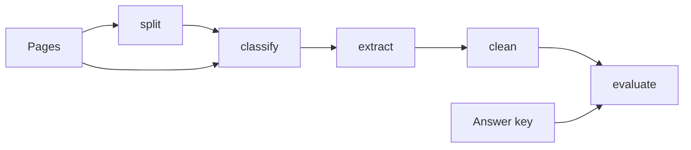

# Document extraction pipeline

Reads pages of business documents with a vision-language model and writes the fields of each page as JSON
lines. Given an answer key, it also scores what it read.

The document types it is measured on are receipts, invoices and bank statements. Field lists for travel
documents and vehicle logbooks are also defined, in `config/field_definitions.yaml`.

It does one job, with two models, through one way in.

## What happens to a page



Each box is a task. A task is one start of `entrypoint.sh`, so that the same tasks run by hand on a GPU
server and as the steps of a pipeline job. Every task reads and writes files under one output folder, which
is how one task finds what another wrote.

## The six tasks

| Task | Uses the cards | Reads | Writes under `output` |
|---|---|---|---|
| `split` | yes | the photographs in `image_dir` | `split/images/`: one image for each document in a photograph, straightened where its rows of print drift |
| `classify` | yes | the pages in `image_dir` | `classifications.jsonl`: the document type of each page |
| `extract` | yes | `classifications.jsonl` and the pages | `raw_extractions.jsonl`: the model's reply for each page |
| `clean` | no | `raw_extractions.jsonl` | `cleaned_extractions.jsonl`: the replies parsed into fields and tidied |
| `evaluate` | no | `cleaned_extractions.jsonl` and the answer key | `evaluation/`: each field scored, with the totals |
| `sroie` | yes | the public SROIE receipts named under `pipeline.sroie` in the settings file | the benchmark's score, in the folder that block names |

`split` is optional. It is for photographs that may hold several documents or sit at an angle. When it has
run, give the later tasks `image_dir=<output>/split/images`.

`sroie` stands apart from the other five: it reads a public benchmark of 347 receipts with the same model
stack, so that a model can be compared with published results.

A task carries on from where an earlier run stopped: pages already read are not read again. Set
`CLEAR_PREV_OUTPUT=true` to delete that task's earlier output and start it afresh.

A page that cannot be read does not end a task: it is recorded with its error, the task goes on, and
the next run of the task reads that page again. A task does stop, with its reason and exit code 1, when
as many requests in a row have failed, with none answered between them, as
`pipeline.processing.stop_after_failed_requests` allows: the engine has stopped answering, or a setting
makes every page fail. The `extract` task also reads again a page that has been given another document
type since it was read.

A task that is stopped part way keeps what it had read. Each record goes into a journal beside the
task's output the moment it is made (`<output file>.journal`), however the engines are arranged, and the
next run adds the journal to the output before it carries on. The output itself is always in the order of
the pages, never the order the cards finished them in.

Because a task carries on from what its output folder holds, a folder belongs to one run. `split`,
`classify` and `extract` each note in `<output>/run_manifest.json` the model, the folder of pages and the
commit of the code they were run with. A task that finds its own earlier note from another model, folder
of pages or commit stops before any work and says what differs: give the run a folder of its own, or
start the task afresh. `clean` and `evaluate` print what the notes hold, so that a score carries the model
and the commit that produced it.

## The two models

| Model | What it is | How it sits on two 24 GB cards |
|---|---|---|
| `gemma4-31b-w4a16-vllm` | Gemma 4 31B, quantised to 4-bit weights | One engine spread across both cards: it does not fit on one |
| `gemma4-12b-unified-w4a16-vllm` | Gemma 4 12B, quantised to 4-bit weights by its maker | One engine on each card, each reading its share of the pages |

Both arrangements read pages through the same code. An engine on each card is given its share of the pages
and runs exactly what a single engine runs.

Both models run on vLLM 0.29.0 in one conda environment, `conda_envs/vllm_env4.yaml`.

## Running a task

```bash
KFP_TASK=classify \
model=gemma4-31b-w4a16-vllm \
image_dir=/data/pages \
output=/data/run_20261121 \
DOC_EXTRACT_LOG_DIR=/data/run_20261121/logs \
bash entrypoint.sh
```

Run it from the repository's own folder. The script prepares the machine (the conda environment, the CUDA
and vLLM variables, a log file, a look at the cards) and then starts `python3 -m stages`, which works out
the task's settings and runs it.

A whole run is the tasks one after another with the same `model` and `output`:

```bash
for task in classify extract clean evaluate; do
  KFP_TASK=$task model=gemma4-31b-w4a16-vllm image_dir=/data/pages output=/data/run_20261121 \
    ground_truth=/data/pages/ground_truth.jsonl DOC_EXTRACT_LOG_DIR=/data/run_20261121/logs \
    bash entrypoint.sh
done
```

## What a job may set

Each setting is taken from the environment if it is set there, and otherwise from `config/run_config.yml`.
A variable that is unset, empty or the word `None` counts as not set. A setting a task needs that is in
neither place stops the run before any work is done, with a message that says what is missing, where to put
it, what it should look like and how to mend it.

| Variable | Meaning | Needed by | Key in `run_config.yml` when unset | Name before 21 November 2026 |
|---|---|---|---|---|
| `KFP_TASK` | The task to run | every start | none: it must be set | unchanged |
| `model` | A registered model | every task | `bootstrap.model.type` | unchanged |
| `image_dir` | The folder of pages | `split`, `classify`, `extract` | `pipeline.information_extraction.input.dir` | unchanged |
| `output` | The folder the tasks write to | every task | `pipeline.information_extraction.output.dir` | unchanged |
| `ground_truth` | The answer key, a JSON lines file (`.jsonl`) | `evaluate` | `pipeline.information_extraction.input.ground_truth` | unchanged |
| `CLEAR_PREV_OUTPUT` | `true` deletes the task's earlier output first | optional, default `false` | none | unchanged |
| `sroie_max_images` | Score only the first N receipts of the benchmark | optional, `sroie` only | none | unchanged |
| `DOC_EXTRACT_LOG_DIR` | The folder for the log | every task | `bootstrap.logging.log_dir` | `LMM_LOG_DIR` |
| `DOC_EXTRACT_CONDA_ENV` | The conda environment's folder | optional | none: the default is in `entrypoint.sh` | `LMM_CONDA_ENV` |
| `DOC_EXTRACT_GPU_MEMORY_UTILIZATION` | The share of each card's memory the engine may take | optional | `inference.vllm` | `LMM_GPU_MEMORY_UTILIZATION` |

A job that still sets a variable under the old `LMM_` prefix is refused with a message naming the new
variables. It is not run with the setting silently dropped.

The number of cards is not a variable. It comes from `bootstrap.gpus` in the settings file.

## The settings file

`config/run_config.yml` holds every setting that is not one of the variables above: the engine's limits for
each model, the completion budgets, the classification and extraction rules, batch sizes. Two rules hold
throughout:

- **Nothing is defaulted in Python.** A key the code needs and does not find stops the run with a message.
- **A key the code does not know is refused.** A misspelt key cannot sit in the file doing nothing.

## Adding a New Document Class

A document class (the files call it a document type) is a block in the schema file and a prompt of the
same name. Nothing in Python names a type or a field, so adding one changes no code: three YAML files
and, to score it, an answer key.

| What | Where | Needed |
|---|---|---|
| The type's block: its fields | `config/field_definitions.yaml`, under `document_types` | always |
| An entry for each new field | `config/field_definitions.yaml`, under `fields` | for each field no other type has |
| The type's prompt | `prompts/extraction_prompts.yaml`, under `prompts` | always |
| A rule that recognises it | `prompts/document_type_detection.yaml`, under `classification_evidence.rules` | to have pages classified as it |
| A question that tells it apart | the same file, under `classification.questions` | only if no question asked already does |
| Its batch size and its place in the order | `config/run_config.yml` | optional |
| Its answers | the answer key, a JSON lines file | to score it |

The steps below add a payslip. Every name and value in them is made up.

### 1. The type's block

Under `document_types` in `config/field_definitions.yaml`. The name is in lower case; pages of the type
are recorded under it in capitals (`PAYSLIP`).

```yaml
  payslip:
    also_called:          # optional: other names a reply may give the type
      - payslip
      - pay slip
      - pay advice
    fields:               # what its prompt asks for, and what it is scored on
      - DOCUMENT_TYPE
      - BUSINESS_ABN
      - EMPLOYER_NAME
      - EMPLOYEE_NAME
      - PAY_PERIOD
      - PAY_DATE
      - EARNINGS_DESCRIPTIONS
      - EARNINGS_AMOUNTS
      - GROSS_PAY
      - TAX_WITHHELD
      - NET_PAY
```

A block may also hold `completion_tokens`, a fixed limit on the length of a reply, for a type whose pages
run long. Without it the limit is worked out from the number of fields. A type whose list fields are the
columns of one table may hold a `table`, which says how the rows of a reply and of the answer are lined
up before they are compared. The head of the file describes both, and the bank statement uses both.

### 2. An entry for each new field

Under `fields` in the same file. `DOCUMENT_TYPE` and `BUSINESS_ABN` have entries already, since other
types use them, so the payslip needs nine:

```yaml
  EMPLOYER_NAME:                {cleaned_as: text, list: false, scored_as: text}
  EMPLOYEE_NAME:                {cleaned_as: text, list: false, scored_as: text}
  PAY_PERIOD:                   {cleaned_as: date, list: false, scored_as: date}
  PAY_DATE:                     {cleaned_as: day_month_year, list: false, scored_as: date}
  EARNINGS_DESCRIPTIONS:        {cleaned_as: text, list: true, scored_as: text}
  EARNINGS_AMOUNTS:             {cleaned_as: money, list: true, scored_as: money}
  GROSS_PAY:                    {cleaned_as: money, list: false, scored_as: money}
  TAX_WITHHELD:                 {cleaned_as: money, list: false, scored_as: money}
  NET_PAY:                      {cleaned_as: money, list: false, scored_as: money}
```

An entry says three things, and all three must be written out:

- `cleaned_as`: how a value in a reply is tidied, so that one answer written two ways compares as the
  same. One of `text`, `money`, `amount_as_written`, `quantity`, `date`, `day_month_year`, `identifier`,
  `address`, `document_type`.
- `list`: `true` for a field that holds several entries, written with ` | ` between them.
- `scored_as`: how a value is compared with the answer. One of `text`, `money`, `date`, `yes_no`,
  `identifier`.

The comments above `fields` in the file say what each of these does. A field is named in capitals with
underscores.

### 3. The type's prompt

Under `prompts` in `prompts/extraction_prompts.yaml`, under the same name as the block. It asks for the
block's fields, one a line, in the form the shipped prompts use:

```yaml
  payslip:
    name: "Payslip Extraction"
    description: "Extract 11 payslip fields"
    prompt: |
      Extract ALL data from this payslip image. Respond in exact format below with actual values or NOT_FOUND.

      DOCUMENT_TYPE: PAYSLIP
      BUSINESS_ABN: NOT_FOUND
      EMPLOYER_NAME: NOT_FOUND
      EMPLOYEE_NAME: NOT_FOUND
      PAY_PERIOD: NOT_FOUND
      PAY_DATE: NOT_FOUND
      EARNINGS_DESCRIPTIONS: NOT_FOUND
      EARNINGS_AMOUNTS: NOT_FOUND
      GROSS_PAY: NOT_FOUND
      TAX_WITHHELD: NOT_FOUND
      NET_PAY: NOT_FOUND

      Write a list with " | " between its entries, in the order the rows are printed.
```

A reply is read as lines of `FIELD_NAME: value`. A field the reply does not give is `NOT_FOUND`.

**No example in a prompt may hold a value from a set of pages the prompt will be scored on.** The model
reads the prompt: a real name, amount or date in it hands the model part of an answer. Describe the form
of an answer, or make the example up and check that it appears in no answer key.

### 4. A rule that recognises it

A page's type is not asked of the model. The model is asked questions about what can be seen on the page,
and the type is worked out from its answers by the rules in `prompts/document_type_detection.yaml`. The
rules are tried from the top and the first that fits gives the type, so where a rule is put matters.

If the answers to the questions already asked tell the new type apart, a rule is enough. A rule may use
the roles of a table's column headings (`any_roles`, `all_roles`, from `column_roles` in the same file)
and the answer to any YES or NO question, by its label in lower case.

A payslip is not told apart by the four questions shipped, so it needs a question as well. Under
`classification.questions`, after the others:

```yaml
    - label: PAYSLIP
      answer: yes_no
      ask: |
        Is this a payslip or pay advice (showing an employee, a
        pay period, and gross and net pay)? Answer YES or NO.
```

and under `classification_evidence.rules`, above the rule for `RECEIPT`, since a payslip also shows that
a payment was made:

```yaml
    - type: PAYSLIP
      when: { payslip: true }
```

**A new question changes what every page is asked**, not only pages of the new type. Classification must
then be measured again for every type (step 7). A new rule alone changes nothing that is sent to the
model. There may be nine questions at most.

A type with no rule is still a type: a page can be read as it, but no page will be classified as it.

### 5. Optional settings

In `config/run_config.yml`. Neither is needed for the type to work.

- `pipeline.batching.payslip`: how many of its pages go to the engine in one call. Without it the type
  has `pipeline.batching.default`.
- `pipeline.extraction.order`: the order the types are read in. A type that is not listed is read last.

### 6. Its answers

To score the type, the answer key needs a line for each of its pages. The key is a JSON lines file: one
answer a line, holding the page's file name and its own type's fields. A page is scored on exactly the
fields its answer carries, so a field left out of an answer is not scored.

```json
{"filename": "payslip_001.png", "DOCUMENT_TYPE": "PAYSLIP", "BUSINESS_ABN": "51824753556", "EMPLOYER_NAME": "Quillfeather Books Pty Ltd", "EMPLOYEE_NAME": "Marigold Tansley", "PAY_PERIOD": "01/02/2031 - 14/02/2031", "PAY_DATE": "16/02/2031", "EARNINGS_DESCRIPTIONS": "Ordinary hours | Overtime", "EARNINGS_AMOUNTS": "$2150.00 | $187.50", "GROSS_PAY": "$2337.50", "TAX_WITHHELD": "$512.00", "NET_PAY": "$1825.50"}
```

A field that is not on the page is `NOT_FOUND` in its answer, and a list is written with ` | ` between its
entries, as a reply writes it.

### 7. Check it, then measure it

From the repository's folder, on any machine, with no model:

```bash
python -c "
from common.prompt_catalog import PromptCatalog
catalog = PromptCatalog()
for model in ('gemma4-31b-w4a16-vllm', 'gemma4-12b-unified-w4a16-vllm'):
    catalog.check_extraction_prompts(model)
catalog.get_classification_evidence()
print(catalog.classification_prompt())
"
```

It prints the classification prompt as the model will be sent it, or stops with what is wrong. Each of
these stops it, and stops a run in the same way, with a message that says which and where:

- a type with no prompt, or a prompt with no type;
- a field a type names that has no entry, or an entry missing one of its three parts;
- a key in a block or an entry that the pipeline does not know;
- a rule for a type that has no block, or one that uses a column role or a question nobody defined;
- a batch size in the settings file for a name that is no type.

Then run the tests (see below). If a question was added, the tests that hold the classification prompt
and its recorded replies fixed will fail, as they are meant to: what the model is sent has changed. Their
records are written again on purpose, and each of those test files says how.

Last, measure on the cards. Run the new type's pages through `classify`, `extract`, `clean` and
`evaluate`. If a question was added, run the existing sets through `classify` as well and compare the
types with an earlier run: a question that helps one type can cost another.

`docs/document_classification.md` has the detail of how the answers become a type.

## Adding a model

1. **Register it** in `models/registry.py`, with one `register_vllm_model(VllmSpec(...))` call beside the
   two that are there. The specification holds what is true of the model itself: its name, its prompt
   file, and whether it can run as one engine on each card.
2. **Give it its settings** in `config/run_config.yml`: the folder of its weights under
   `bootstrap.model.default_paths`, and its engine limits in a block under `inference.vllm.models`.

Then name it in `model`.

## Tests

The tests need no GPU and load no model.

```bash
conda run --no-capture-output -n du pytest -n auto --dist worksteal -m "not slow" -q
```

Two of them hold the pipeline's behaviour fixed, and are the ones to watch when changing code:

- `tests/replay/test_replay.py` runs `clean` and `evaluate` on recorded model replies and compares the
  result with a recorded one, to the byte.
- `tests/reference/test_model_inputs.py` records exactly what each task sends to the model, for both
  models, and compares it with the two JSON files beside it.

A change that alters either has changed what the pipeline does. The recorded files are regenerated only
when that change is intended.

## Where things are

| Folder | Holds |
|---|---|
| `stages/` | One module for each task, and `__main__.py`, which starts the task `KFP_TASK` names |
| `common/` | What the tasks share: settings, parsing, cleaning, scoring, the page finder, the SROIE benchmark |
| `models/` | The model registry, the vLLM engine loader, and the code that builds prompts and reads replies |
| `config/` | `run_config.yml` and `field_definitions.yaml` |
| `prompts/` | The classification and extraction prompts |
| `docs/` | How documents are classified, and setting up the 12B model on a new machine |
| `conda_envs/` | The conda environment |
