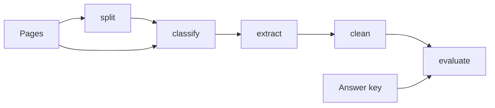
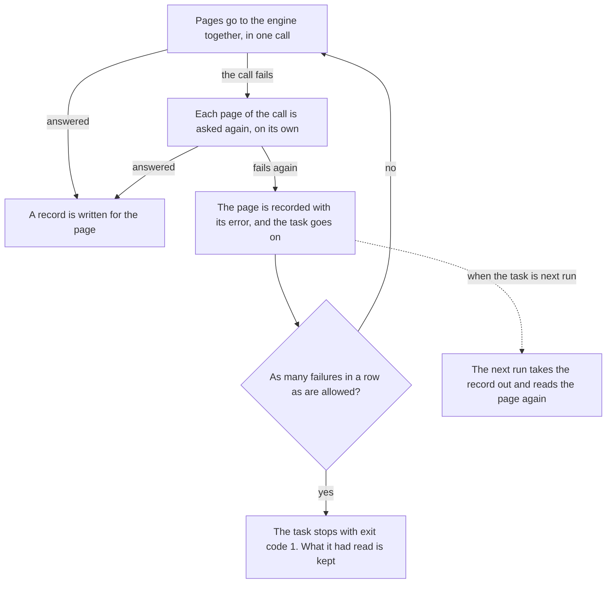

# Document extraction pipeline

Reads pages of business documents with a vision-language model and writes the fields of each page as JSON
lines. Given an answer key, it also scores what it read.

The document types it is measured on are receipts, invoices and bank statements. Field lists for travel
documents and vehicle logbooks are also defined, in `config/field_definitions.yaml`.

It does one job, with two models, through one way in.

## What happens to a page



Each box is a task. A task is one start of `entrypoint.sh`, so that the same tasks run by hand on a GPU
server and as the steps of a pipeline job. Every task reads and writes files under one output folder, which
is how one task finds what another wrote.

## The five tasks

| Task | Uses the cards | Reads | Writes under `output` |
|---|---|---|---|
| `split` | yes | the photographs in `image_dir` | `split/images/`: one image for each document in a photograph, straightened where its rows of print drift |
| `classify` | yes | the pages in `image_dir` | `classifications.jsonl`: the document type of each page |
| `extract` | yes | `classifications.jsonl` and the pages | `raw_extractions.jsonl`: the model's reply for each page |
| `clean` | no | `raw_extractions.jsonl` | `cleaned_extractions.jsonl`: the replies parsed into fields and tidied |
| `evaluate` | no | `cleaned_extractions.jsonl` and the answer key | `evaluation/`: each field scored, with the totals |

`split` is optional. It is for photographs that may hold several documents or sit at an angle. When it has
run, give the later tasks `image_dir=<output>/split/images`.

A set of pages that are all of one type, known beforehand, is read by the same tasks: see
[Reading a dataset whose pages are all of one type](#reading-a-dataset-whose-pages-are-all-of-one-type).

A task carries on from where an earlier run stopped: pages already read are not read again. Set
`CLEAR_PREV_OUTPUT=true` to delete that task's earlier output and start it afresh.

A page that cannot be read does not end a task, and is read again by the task's next run: see
[How a failed page is tried again](#how-a-failed-page-is-tried-again).

A task that is stopped part way keeps what it had read. Each record goes into a journal beside the
task's output the moment it is made (`<output file>.journal`), however the engines are arranged, and the
next run adds the journal to the output before it carries on. A task's output is in the order of its
pages however the run went: straight through, stopped and started again, or with failed pages read
again. It is never in the order the cards finished them in.

Because a task carries on from what its output folder holds, a folder belongs to one run. `split`,
`classify` and `extract` each note in `<output>/run_manifest.json` the model, the folder of pages and the
commit of the code they were run with. A task that finds its own earlier note from another model, folder
of pages or commit stops before any work and says what differs: give the run a folder of its own, or
start the task afresh. `clean` and `evaluate` print what the notes hold, so that a score carries the model
and the commit that produced it.

## The design

Five tasks make the pipeline: `split`, `classify`, `extract`, `clean` and `evaluate`. They are built to
be modular, so that any one can be run, tested or replaced alone, and cohesive, so that all five behave
alike. Each choice below is a well-known pattern, used for the reason given.

### The patterns

| Pattern | Where it is | Why it is used |
|---|---|---|
| **Pipes and filters** | Each task is a filter and each file under `output` is a pipe: `classifications.jsonl` carries `classify`'s work to `extract`, and so on | A task knows only the file it reads and the file it writes. Any task can be run again on files an earlier run left, on another machine, without the tasks before it |
| **Strategy** | `stages/carry_on.py` is one fixed sequence. Each task that uses the cards hands it the part that differs: how that task asks the model (`classify_pages`, `extract_pages`, `ask_about_photographs`) | Carrying on from an earlier run is written once, not once a task. A fix to it is one fix |
| **Write-ahead journal** | `<output file>.journal`, written by `Journal` in `stages/io.py` | Each record is on disk the moment the model gives it. A run stopped at page 100 of 165 loses nothing |
| **Checkpoint and restart** | `carry_on`: recover the journal, take out the failed records, read only what is left | A run that carries on ends with the records, in the order, that a run straight through would have written |
| **Atomic write** | `write_jsonl` and `in_the_order` in `stages/io.py` write beside the file and rename it into place. They are the only two ways a task's output is written | A reader finds the old file or the new one, never half of one |
| **Retry, then stop** | `common/engine_calls.py`: a failed engine call is tried again one page at a time, and a task stops when request after request fails | One bad page costs one page. An engine that has stopped answering costs seconds, not a file of failures |
| **Registry** | `models/registry.py` | A model is one entry there, with whether it fits an engine on each card. No task's code depends on which model it is given |
| **Settings as data, checked first** | `config/run_config.yml` and `config/field_definitions.yaml` hold every setting, field and threshold. Nothing is defaulted in Python | What a run is set to do can be read from two files. A mistake stops the run before an engine starts, with what is wrong, where, what is expected and the fix |
| **Recorded-result tests** | `tests/replay/` and `tests/reference/` | A change that alters a score, or what the model is sent, fails a test by a byte |

How the engines are arranged is kept apart from all of this. `common/vllm_dp.py` starts one engine
across the cards or one on each card, and the task's reading function is the same either way.

### What every task keeps to

Seven rules, which `tests/stages/test_every_stage_keeps_the_contract.py` holds.

A task stands alone:

1. It is one module of `stages/` with a `BANNER`, a `check(task)` and a `start(task)`. The runner knows
   no more. `check` reads everything the task will use and writes nothing, and the runner calls it
   before the note of what made the folder is written and before a task started afresh deletes its
   earlier output: a task that cannot start leaves the folder as it found it.
2. It reads its settings and the file the task before it wrote, and writes its own file. It imports no
   other task.
3. A record handed from one task to the next is made by `stages/records.py` and by nothing else.

The five behave alike:

4. A task's output holds one record for each item of its input, in the task's own order.
5. That output holds the same records in the same order whether the run went straight through, was
   stopped and started again, or had failed pages read again. Only a page's time, and the card that
   read it, can differ.
6. An output file is put in place whole, by `stages/io.py` and by no task itself. Nothing is added to
   a file where it stands: a run stopped at any moment leaves the file as it was or as it is to be.
7. A task that uses the cards carries on by `stages/carry_on.py`, and notes a row of its time in
   `<output>/.stage_timing.jsonl`.

What the tasks share is three modules of functions that a task calls: `stages/io.py` for files,
`stages/records.py` for records and `stages/carry_on.py` for carrying on. None of them calls a task, and
there is no base class to inherit from: a task's `run` is still the place to read what that task does.

`clean` and `evaluate` use no cards and take seconds, so each is rebuilt whole on every run.

## Reading a dataset whose pages are all of one type

Some sets of pages are all of one document type, known beforehand: the receipts of a public dataset,
say. Such a set is described in the YAML files and read by the five tasks. There is no code for it.

A dataset is four entries. The receipts of the public SROIE test split are the one shipped:

```yaml
# config/field_definitions.yaml: the type and its fields, each of a kind the pipeline cleans and scores
document_types:
  sroie_receipt:
    completion_tokens: 256
    fields: [COMPANY, DATE, ADDRESS, TOTAL]

# prompts/extraction_prompts.yaml: a prompt of the type's name
prompts:
  sroie_receipt:
    prompt: |
      Read this scanned receipt and report four fields. ...

# config/run_config.yml: how many of its pages go to the engine in one call, and the dataset itself
pipeline:
  batching:
    sroie_receipt: 64
  datasets:
    sroie:
      document_type: SROIE_RECEIPT
      image_dir: /data/sroie/test/img    # or null, for the job to name
```

A job reads it by naming it:

```bash
for task in classify extract clean; do
  KFP_TASK=$task dataset=sroie model=gemma4-31b-w4a16-vllm output=/data/run_sroie \
    DOC_EXTRACT_LOG_DIR=/data/run_sroie/logs bash entrypoint.sh
done
```

- `classify` gives every page the dataset's type and asks no model: it starts no engine. Each record
  says so, with `type_from: dataset`.
- `extract`, `clean` and `evaluate` read the pages as they read any others: by the type's prompt, its
  fields and their kinds. A run of a dataset keeps the model's replies, carries on from where it
  stopped and reads a failed page again, like any run.
- The job's own `image_dir` stands in place of the dataset's when it is set.
- `evaluate` wants an answer key in the pipeline's form: JSON lines, a line a page, with the page's file
  name and the type's fields.

Every dataset in the file is checked when a task starts, whichever the job names. One that is not its
two keys, or whose type the schema file does not have, stops the run and says how to mend it. With no
dataset at all, write `datasets: {}`.

Until 25 November 2026 the SROIE receipts had a task of their own, with its own prompt, parser, scorer
and report, and two scores of its own. They are scored now as every other page is, so a figure from this
pipeline is not one to set beside a published SROIE result.

## How a failed page is tried again

A page can fail for a reason of its own (a file that cannot be opened, a page too long for the model's
context) or because the engine has stopped answering. The two are told apart by what happens around the
page, and each has its own answer. Nothing waits between one try and the next, and no try is hidden:
each is a line in the log.



### Inside a run

1. **Pages share an engine call.** How many is in `pipeline.batching`. A call that fails says nothing
   about which of its pages was at fault.
2. **So each page of a failed call is asked again on its own, once.** One bad page then costs the pages
   it shared a call with only that call.
3. **A page that fails on its own is recorded with its error, and the task goes on.** It is not tried a
   third time in that run.

What the record of a failed page holds:

| Task | The record | What the later tasks do with it |
|---|---|---|
| `split` | `error`, and the reason "the model could not be asked". The photograph is passed through as it is | `classify` reads the photograph whole |
| `classify` | `error`, the fallback type (`pipeline.classification.fallback_type`), and `type_from: fallback_not_asked` | `extract` reads the page as that type |
| `extract` | `error`, an empty reply, and `prompt_used: error` | `clean` passes the error on with no fields. `evaluate` counts the page under "Failed Extraction" and leaves it out of the mean, and gives the mean again with each failed page as 0 |

A task that ends with failed pages says how many in its last lines, and exits with code 0.

A page can also be given the fallback type with no failure at all: the model answered, and the rules
could make nothing of the answer. Its record has no `error`. Every classification record therefore says
how its type was reached, in `type_from`:

| `type_from` | The type is |
|---|---|
| `rule` | the type of the first rule of the classification file that fitted the reply's answers |
| `default` | the file's default type: the answers were read and no rule fitted |
| `fallback_no_answers` | the fallback type: the reply held no answers that could be read |
| `fallback_no_rule` | the fallback type: no rule fitted, and the file has no default |
| `fallback_not_asked` | the fallback type: the model could not be asked, or its reply not read |

`classify` counts its pages by these, and warns of those given the fallback type, by name. Such a page is
not read again by the next run unless it also failed: the model has answered, and would answer the same.

### When the task is next run

A task carries on from its earlier output. Before it does, it takes the failed pages' records out of
that output, so that those pages are read again with any that are new:

- `classify` asks again about each page it could not classify;
- `extract` reads again each page it could not read, and each page that has been given another
  document type since it was read, whose record is of the wrong fields. A page `classify` got right the
  second time is therefore read again under its own type;
- `split` asks again about each photograph it could not ask about, and removes the image it had passed
  through in the photograph's place. Its journal keeps each reply with the record of what was done about
  it, and `splits.jsonl` is written when it has finished: a run that carries on does nothing a second
  time about a photograph an earlier run had finished.

Three things follow:

- A page that can never be read is tried on every run. A run with nothing new to read but one such page
  starts an engine to try it. No setting leaves such a page out.
- A run with no failed page and nothing new starts no engine.
- A page read again is put back in its place among the others. The output is then the file a run
  with no failed page would have written.

`CLEAR_PREV_OUTPUT=true` reads every page again, failed or not.

### When the task stops instead

A page that fails among pages that are answered is that page's own failure. When request after request
fails with none answered between them, it is not: the engine has stopped answering, or a setting makes
every page fail (a context length too short for every statement, say). Going on would record every page
left as failed, in seconds.

So each engine counts the requests that fail one after another. A page asked on its own that fails
adds one. A call that fails does not count by itself: its pages do, as each is asked alone. Any request
or call that is answered sets the count back to nothing. With an engine on each card, each card keeps
its own count.

When the count reaches `pipeline.processing.stop_after_failed_requests` (8 as shipped), the task stops:

- it prints `FATAL: the task was stopped part way.`, with the number of requests, the last error and
  where to look, and exits with code 1;
- every record made before then is kept, in the task's journal, and the next run carries on from it;
- the pages of the call being tried when it stopped are not recorded, and are read by the next run. Any
  page recorded as failed before the count was reached is read again too.

As many unreadable pages next to each other as the number allowed also stop the task: the count cannot
tell them from an engine that has stopped. Raise the number if a folder is known to hold such a run of
pages. A value of 1 stops a task at the first page that fails.

### What is never tried again

- **A setting that cannot be used.** It would fail every page the same way. It ends the run at once with
  `FATAL: the task cannot be started.`, its reason and exit code 1. Each task checks what it reads
  before any engine starts, so this is normally in the first seconds.
- **A reply the model gave.** If `classify` cannot turn a reply into a document type, the page is
  recorded with the error and the reply, and the model is not asked again in that run. The next run
  asks again, as for any failed page.

### How a task ends

| What happened | Exit code | Last lines of the log |
|---|---|---|
| Every page was read | 0 | the count of pages and the time |
| Some pages failed among pages that were answered | 0 | a warning with how many failed |
| As many requests failed in a row as are allowed | 1 | `FATAL: the task was stopped part way.` and why |
| A setting cannot be used | 1 | `FATAL: the task cannot be started.` and why |

## The two models

| Model | What it is | How it sits on two 24 GB cards |
|---|---|---|
| `gemma4-31b-w4a16-vllm` | Gemma 4 31B, quantised to 4-bit weights | One engine spread across both cards: it does not fit on one |
| `gemma4-12b-unified-w4a16-vllm` | Gemma 4 12B, quantised to 4-bit weights by its maker | One engine on each card, each reading its share of the pages |

Both arrangements read pages through the same code. An engine on each card is given its share of the pages
and runs exactly what a single engine runs. That holds for every task that uses the model: `split`,
`classify` and `extract`.

Both models run on vLLM 0.29.0 in one conda environment, `conda_envs/vllm_env4.yaml`.

## Running a task

```bash
KFP_TASK=classify \
model=gemma4-31b-w4a16-vllm \
image_dir=/data/pages \
output=/data/run_20261121 \
DOC_EXTRACT_LOG_DIR=/data/run_20261121/logs \
bash entrypoint.sh
```

Run it from the repository's own folder. The script prepares the machine (the conda environment, the CUDA
and vLLM variables, a log file, a look at the cards) and then starts `python3 -m stages`, which works out
the task's settings and runs it.

A whole run is the tasks one after another with the same `model` and `output`:

```bash
for task in classify extract clean evaluate; do
  KFP_TASK=$task model=gemma4-31b-w4a16-vllm image_dir=/data/pages output=/data/run_20261121 \
    ground_truth=/data/pages/ground_truth.jsonl DOC_EXTRACT_LOG_DIR=/data/run_20261121/logs \
    bash entrypoint.sh
done
```

## What a job may set

Each setting is taken from the environment if it is set there, and otherwise from the settings file:
`config/run_config.yml`, or the file the job names in `run_config`.
A variable that is unset, empty or the word `None` counts as not set. A setting a task needs that is in
neither place stops the run before any work is done, with a message that says what is missing, where to put
it, what it should look like and how to mend it.

The four folders (`image_dir`, `output`, `ground_truth` and `DOC_EXTRACT_LOG_DIR`) are null in the settings
file as shipped, so a job names each folder its task needs. A folder written into the file would be one
machine's, and a run that forgot to name its own would read it, or write into it, without a word. A task
is asked only for the folders it uses: `clean` and `evaluate` for no folder of pages.

| Variable | Meaning | Needed by | Key in `run_config.yml` when unset | Name before 21 November 2026 |
|---|---|---|---|---|
| `KFP_TASK` | The task to run | every start | none: it must be set | unchanged |
| `model` | A registered model | every task | `bootstrap.model.type` | unchanged |
| `image_dir` | The folder of pages | `split`, `classify`, `extract` | `pipeline.information_extraction.input.dir` | unchanged |
| `output` | The folder the tasks write to | every task | `pipeline.information_extraction.output.dir` | unchanged |
| `ground_truth` | The answer key, a JSON lines file (`.jsonl`) | `evaluate` | `pipeline.information_extraction.input.ground_truth` | unchanged |
| `dataset` | A dataset of the settings file, whose pages are all of one type: `classify` gives each page that type and asks no model, and the dataset's folder of pages is read unless `image_dir` is set | optional | a block under `pipeline.datasets` | new |
| `run_config` | A settings file of the job's own, read whole in place of `config/run_config.yml` | optional | none: unset, the shipped file is read | new |
| `CLEAR_PREV_OUTPUT` | `true` deletes the task's earlier output first | optional, default `false` | none | unchanged |
| `DOC_EXTRACT_LOG_DIR` | The folder for the log | every task | `bootstrap.logging.log_dir` | `LMM_LOG_DIR` |
| `DOC_EXTRACT_CONDA_ENV` | The conda environment's folder | optional | none: the default is in `entrypoint.sh` | `LMM_CONDA_ENV` |
| `DOC_EXTRACT_GPU_MEMORY_UTILIZATION` | The share of each card's memory the engine may take | optional | `inference.vllm` | `LMM_GPU_MEMORY_UTILIZATION` |

A job that still sets a variable under the old `LMM_` prefix is refused with a message naming the new
variables. It is not run with the setting silently dropped.

The number of cards is not a variable. It comes from `bootstrap.gpus` in the settings file.

## The settings file

`config/run_config.yml` holds every setting that is not one of the variables above: the engine's limits for
each model, the completion budgets, the classification and extraction rules, batch sizes. Two rules hold
throughout:

- **Nothing is defaulted in Python.** A key the code needs and does not find stops the run with a message.
- **A key the code does not know is refused.** A misspelt key cannot sit in the file doing nothing.

### A run with settings of its own

The shipped file is in the code's folder, and a job often cannot write there: under a pipeline the code is
read-only, and the storage a job can write to is mounted beside it. So a setting is never changed by editing
the shipped file in place. Copy it to storage the job can read, change what the run needs changed, and name
the copy:

```bash
cp config/run_config.yml /data/run_20261126/run_config.yml
# edit /data/run_20261126/run_config.yml
KFP_TASK=classify run_config=/data/run_20261126/run_config.yml model=gemma4-31b-w4a16-vllm \
  image_dir=/data/pages output=/data/run_20261126 DOC_EXTRACT_LOG_DIR=/data/run_20261126/logs \
  bash entrypoint.sh
```

- **The file named is the whole of the settings.** Nothing is merged from the shipped file. It is read and
  checked exactly as the shipped file is, so a key it leaves out is missing and a key the code does not know
  is refused. What a run was set to do can be read from that one file.
- **Every task of a run names the same file.** Each task that uses the cards notes the file it read, and
  the SHA-256 of its contents, in `run_manifest.json`. A task that carries on with other settings than it
  began with is allowed, and says so.
- **The log folder comes from the same file**, when the job does not set `DOC_EXTRACT_LOG_DIR`.

The document types, their fields and the prompts are not settings of a run: they are part of the code, in
`config/field_definitions.yaml` and `prompts/`, and are named by the commit.

## Adding a New Document Class

A document class (the files call it a document type) is a block in the schema file and a prompt of the
same name. Nothing in Python names a type or a field, so adding one changes no code: three YAML files
and, to score it, an answer key.

| What | Where | Needed |
|---|---|---|
| The type's block: its fields | `config/field_definitions.yaml`, under `document_types` | always |
| An entry for each new field | `config/field_definitions.yaml`, under `fields` | for each field no other type has |
| The type's prompt | `prompts/extraction_prompts.yaml`, under `prompts` | always |
| A rule that recognises it | `prompts/document_type_detection.yaml`, under `classification_evidence.rules` | to have pages classified as it |
| A question that tells it apart | the same file, under `classification.questions` | only if no question asked already does |
| Its batch size and its place in the order | `config/run_config.yml` | optional |
| Its answers | the answer key, a JSON lines file | to score it |

The steps below add a payslip. Every name and value in them is made up.

### 1. The type's block

Under `document_types` in `config/field_definitions.yaml`. The name is in lower case; pages of the type
are recorded under it in capitals (`PAYSLIP`).

```yaml
  payslip:
    also_called:          # optional: other names a reply may give the type
      - payslip
      - pay slip
      - pay advice
    fields:               # what its prompt asks for, and what it is scored on
      - DOCUMENT_TYPE
      - BUSINESS_ABN
      - EMPLOYER_NAME
      - EMPLOYEE_NAME
      - PAY_PERIOD
      - PAY_DATE
      - EARNINGS_DESCRIPTIONS
      - EARNINGS_AMOUNTS
      - GROSS_PAY
      - TAX_WITHHELD
      - NET_PAY
```

A block may also hold `completion_tokens`, a fixed limit on the length of a reply, for a type whose pages
run long. Without it the limit is worked out from the number of fields. A type whose list fields are the
columns of one table may hold a `table`, which says how the rows of a reply and of the answer are lined
up before they are compared. The head of the file describes both, and the bank statement uses both.

### 2. An entry for each new field

Under `fields` in the same file. `DOCUMENT_TYPE` and `BUSINESS_ABN` have entries already, since other
types use them, so the payslip needs nine:

```yaml
  EMPLOYER_NAME:                {cleaned_as: text, list: false, scored_as: text}
  EMPLOYEE_NAME:                {cleaned_as: text, list: false, scored_as: text}
  PAY_PERIOD:                   {cleaned_as: date, list: false, scored_as: date}
  PAY_DATE:                     {cleaned_as: day_month_year, list: false, scored_as: date}
  EARNINGS_DESCRIPTIONS:        {cleaned_as: text, list: true, scored_as: text}
  EARNINGS_AMOUNTS:             {cleaned_as: money, list: true, scored_as: money}
  GROSS_PAY:                    {cleaned_as: money, list: false, scored_as: money}
  TAX_WITHHELD:                 {cleaned_as: money, list: false, scored_as: money}
  NET_PAY:                      {cleaned_as: money, list: false, scored_as: money}
```

An entry says three things, and all three must be written out:

- `cleaned_as`: how a value in a reply is tidied, so that one answer written two ways compares as the
  same. One of `text`, `money`, `amount_as_written`, `quantity`, `date`, `day_month_year`, `identifier`,
  `address`, `document_type`.
- `list`: `true` for a field that holds several entries, written with ` | ` between them.
- `scored_as`: how a value is compared with the answer. One of `text`, `money`, `date`, `yes_no`,
  `identifier`.

The comments above `fields` in the file say what each of these does. A field is named in capitals with
underscores.

### 3. The type's prompt

Under `prompts` in `prompts/extraction_prompts.yaml`, under the same name as the block. It asks for the
block's fields, one a line, in the form the shipped prompts use:

```yaml
  payslip:
    name: "Payslip Extraction"
    description: "Extract 11 payslip fields"
    prompt: |
      Extract ALL data from this payslip image. Respond in exact format below with actual values or NOT_FOUND.

      DOCUMENT_TYPE: PAYSLIP
      BUSINESS_ABN: NOT_FOUND
      EMPLOYER_NAME: NOT_FOUND
      EMPLOYEE_NAME: NOT_FOUND
      PAY_PERIOD: NOT_FOUND
      PAY_DATE: NOT_FOUND
      EARNINGS_DESCRIPTIONS: NOT_FOUND
      EARNINGS_AMOUNTS: NOT_FOUND
      GROSS_PAY: NOT_FOUND
      TAX_WITHHELD: NOT_FOUND
      NET_PAY: NOT_FOUND

      Write a list with " | " between its entries, in the order the rows are printed.
```

A reply is read as lines of `FIELD_NAME: value`. A field the reply does not give is `NOT_FOUND`.

**No example in a prompt may hold a value from a set of pages the prompt will be scored on.** The model
reads the prompt: a real name, amount or date in it hands the model part of an answer. Describe the form
of an answer, or make the example up and check that it appears in no answer key.

### 4. A rule that recognises it

A page's type is not asked of the model. The model is asked questions about what can be seen on the page,
and the type is worked out from its answers by the rules in `prompts/document_type_detection.yaml`. The
rules are tried from the top and the first that fits gives the type, so where a rule is put matters.

If the answers to the questions already asked tell the new type apart, a rule is enough. A rule may use
the roles of a table's column headings (`any_roles`, `all_roles`, from `column_roles` in the same file)
and the answer to any YES or NO question, by its label in lower case.

A payslip is not told apart by the four questions shipped, so it needs a question as well. Under
`classification.questions`, after the others:

```yaml
    - label: PAYSLIP
      answer: yes_no
      ask: |
        Is this a payslip or pay advice (showing an employee, a
        pay period, and gross and net pay)? Answer YES or NO.
```

and under `classification_evidence.rules`, above the rule for `RECEIPT`, since a payslip also shows that
a payment was made:

```yaml
    - type: PAYSLIP
      when: { payslip: true }
```

**A new question changes what every page is asked**, not only pages of the new type. Classification must
then be measured again for every type (step 7). A new rule alone changes nothing that is sent to the
model. There may be nine questions at most.

A type with no rule is still a type: a page can be read as it, but no page will be classified as it.

### 5. Optional settings

In `config/run_config.yml`. Neither is needed for the type to work.

- `pipeline.batching.payslip`: how many of its pages go to the engine in one call. Without it the type
  has `pipeline.batching.default`.
- `pipeline.extraction.order`: the order the types are read in. A type that is not listed is read last.

### 6. Its answers

To score the type, the answer key needs a line for each of its pages. The key is a JSON lines file: one
answer a line, holding the page's file name and its own type's fields. A page is scored on exactly the
fields its answer carries, so a field left out of an answer is not scored.

```json
{"filename": "payslip_001.png", "DOCUMENT_TYPE": "PAYSLIP", "BUSINESS_ABN": "51824753556", "EMPLOYER_NAME": "Quillfeather Books Pty Ltd", "EMPLOYEE_NAME": "Marigold Tansley", "PAY_PERIOD": "01/02/2031 - 14/02/2031", "PAY_DATE": "16/02/2031", "EARNINGS_DESCRIPTIONS": "Ordinary hours | Overtime", "EARNINGS_AMOUNTS": "$2150.00 | $187.50", "GROSS_PAY": "$2337.50", "TAX_WITHHELD": "$512.00", "NET_PAY": "$1825.50"}
```

A field that is not on the page is `NOT_FOUND` in its answer, and a list is written with ` | ` between its
entries, as a reply writes it.

### 7. Check it, then measure it

From the repository's folder, on any machine, with no model:

```bash
python -c "
from common.prompt_catalog import PromptCatalog
catalog = PromptCatalog()
for model in ('gemma4-31b-w4a16-vllm', 'gemma4-12b-unified-w4a16-vllm'):
    catalog.check_extraction_prompts(model)
catalog.get_classification_evidence()
print(catalog.classification_prompt())
"
```

It prints the classification prompt as the model will be sent it, or stops with what is wrong. Each of
these stops it, and stops a run in the same way, with a message that says which and where:

- a type with no prompt, or a prompt with no type;
- a field a type names that has no entry, or an entry missing one of its three parts;
- a key in a block or an entry that the pipeline does not know;
- a rule for a type that has no block, or one that uses a column role or a question nobody defined;
- a batch size in the settings file for a name that is no type.

Then run the tests (see below). If a question was added, the tests that hold the classification prompt
and its recorded replies fixed will fail, as they are meant to: what the model is sent has changed. Their
records are written again on purpose, and each of those test files says how.

Last, measure on the cards. Run the new type's pages through `classify`, `extract`, `clean` and
`evaluate`. If a question was added, run the existing sets through `classify` as well and compare the
types with an earlier run: a question that helps one type can cost another.

`docs/document_classification.md` has the detail of how the answers become a type.

## Adding a model

1. **Register it** in `models/registry.py`, with one `register_vllm_model(VllmSpec(...))` call beside the
   two that are there. The specification holds what is true of the model itself: its name, its prompt
   file, and whether it can run as one engine on each card.
2. **Give it its settings** in `config/run_config.yml`: the folder of its weights under
   `bootstrap.model.default_paths`, and its engine limits in a block under `inference.vllm.models`.

Then name it in `model`.

## Tests

The tests need no GPU and load no model.

```bash
conda run --no-capture-output -n du pytest -n auto --dist worksteal -m "not slow" -q
```

Two of them hold the pipeline's behaviour fixed, and are the ones to watch when changing code:

- `tests/replay/test_replay.py` runs `clean` and `evaluate` on recorded model replies and compares the
  result with a recorded one, to the byte.
- `tests/reference/test_model_inputs.py` records exactly what each task sends to the model, for both
  models, and compares it with the two JSON files beside it.

A change that alters either has changed what the pipeline does. The recorded files are regenerated only
when that change is intended.

## Where things are

| Folder | Holds |
|---|---|
| `stages/` | One module for each task, and `__main__.py`, which starts the task `KFP_TASK` names. Each task's module has a `BANNER`, and a `check` and a `start` that are each given the task's settings: the runner knows no more of a task than that. Three modules are what the tasks share: `io.py` reads and writes their files, `records.py` defines each record one task hands another and the functions that make it, and `carry_on.py` is the one way a task that uses the cards carries on from an earlier run |
| `common/` | What the tasks share: settings, parsing, cleaning, scoring, the page finder |
| `models/` | The model registry, the vLLM engine loader, and the code that builds prompts and reads replies |
| `config/` | `run_config.yml` and `field_definitions.yaml` |
| `prompts/` | The classification and extraction prompts |
| `docs/` | How documents are classified, and setting up the 12B model on a new machine |
| `conda_envs/` | The conda environment |
