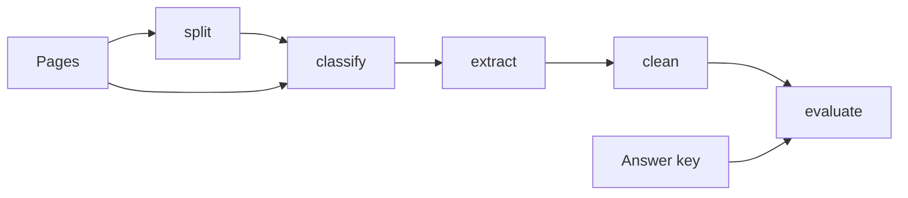

# Document extraction pipeline

Reads pages of business documents with a vision-language model and writes the fields of each page as JSON
lines. Given an answer key, it also scores what it read.

The document types it is measured on are receipts, invoices and bank statements. Field lists for travel
documents and vehicle logbooks are also defined, in `config/field_definitions.yaml`.

It does one job, with two models, through one way in.

## What happens to a page



Each box is a task. A task is one start of `entrypoint.sh`, so that the same tasks run by hand on a GPU
server and as the steps of a pipeline job. Every task reads and writes files under one output folder, which
is how one task finds what another wrote.

## The six tasks

| Task | Uses the cards | Reads | Writes under `output` |
|---|---|---|---|
| `split` | yes | the photographs in `image_dir` | `split/images/`: one image for each document in a photograph, straightened where its rows of print drift |
| `classify` | yes | the pages in `image_dir` | `classifications.jsonl`: the document type of each page |
| `extract` | yes | `classifications.jsonl` and the pages | `raw_extractions.jsonl`: the model's reply for each page |
| `clean` | no | `raw_extractions.jsonl` | `cleaned_extractions.jsonl`: the replies parsed into fields and tidied |
| `evaluate` | no | `cleaned_extractions.jsonl` and the answer key | `evaluation/`: each field scored, with the totals |
| `sroie` | yes | the public SROIE receipts named under `pipeline.sroie` in the settings file | the benchmark's score, in the folder that block names |

`split` is optional. It is for photographs that may hold several documents or sit at an angle. When it has
run, give the later tasks `image_dir=<output>/split/images`.

`sroie` stands apart from the other five: it reads a public benchmark of 347 receipts with the same model
stack, so that a model can be compared with published results.

A task carries on from where an earlier run stopped: pages already read are not read again. Set
`CLEAR_PREV_OUTPUT=true` to delete that task's earlier output and start it afresh.

## The two models

| Model | What it is | How it sits on two 24 GB cards |
|---|---|---|
| `gemma4-31b-w4a16-vllm` | Gemma 4 31B, quantised to 4-bit weights | One engine spread across both cards: it does not fit on one |
| `gemma4-12b-unified-w4a16-vllm` | Gemma 4 12B, quantised to 4-bit weights by its maker | One engine on each card, each reading its share of the pages |

Both arrangements read pages through the same code. An engine on each card is given its share of the pages
and runs exactly what a single engine runs.

Both models run on vLLM 0.29.0 in one conda environment, `conda_envs/vllm_env4.yaml`.

## Running a task

```bash
KFP_TASK=classify \
model=gemma4-31b-w4a16-vllm \
image_dir=/data/pages \
output=/data/run_20261121 \
DOC_EXTRACT_LOG_DIR=/data/run_20261121/logs \
bash entrypoint.sh
```

Run it from the repository's own folder. The script prepares the machine (the conda environment, the CUDA
and vLLM variables, a log file, a look at the cards) and then starts `python3 -m stages`, which works out
the task's settings and runs it.

A whole run is the tasks one after another with the same `model` and `output`:

```bash
for task in classify extract clean evaluate; do
  KFP_TASK=$task model=gemma4-31b-w4a16-vllm image_dir=/data/pages output=/data/run_20261121 \
    ground_truth=/data/pages/ground_truth.jsonl DOC_EXTRACT_LOG_DIR=/data/run_20261121/logs \
    bash entrypoint.sh
done
```

## What a job may set

Each setting is taken from the environment if it is set there, and otherwise from `config/run_config.yml`.
A variable that is unset, empty or the word `None` counts as not set. A setting a task needs that is in
neither place stops the run before any work is done, with a message that says what is missing, where to put
it, what it should look like and how to mend it.

| Variable | Meaning | Needed by | Key in `run_config.yml` when unset | Name before 21 November 2026 |
|---|---|---|---|---|
| `KFP_TASK` | The task to run | every start | none: it must be set | unchanged |
| `model` | A registered model | every task | `bootstrap.model.type` | unchanged |
| `image_dir` | The folder of pages | `split`, `classify`, `extract` | `pipeline.information_extraction.input.dir` | unchanged |
| `output` | The folder the tasks write to | every task | `pipeline.information_extraction.output.dir` | unchanged |
| `ground_truth` | The answer key, a JSON lines file (`.jsonl`) | `evaluate` | `pipeline.information_extraction.input.ground_truth` | unchanged |
| `CLEAR_PREV_OUTPUT` | `true` deletes the task's earlier output first | optional, default `false` | none | unchanged |
| `sroie_max_images` | Score only the first N receipts of the benchmark | optional, `sroie` only | none | unchanged |
| `DOC_EXTRACT_LOG_DIR` | The folder for the log | every task | `bootstrap.logging.log_dir` | `LMM_LOG_DIR` |
| `DOC_EXTRACT_CONDA_ENV` | The conda environment's folder | optional | none: the default is in `entrypoint.sh` | `LMM_CONDA_ENV` |
| `DOC_EXTRACT_GPU_MEMORY_UTILIZATION` | The share of each card's memory the engine may take | optional | `inference.vllm` | `LMM_GPU_MEMORY_UTILIZATION` |

A job that still sets a variable under the old `LMM_` prefix is refused with a message naming the new
variables. It is not run with the setting silently dropped.

The number of cards is not a variable. It comes from `bootstrap.gpus` in the settings file.

## The settings file

`config/run_config.yml` holds every setting that is not one of the variables above: the engine's limits for
each model, the generation settings, the classification and extraction rules, batch sizes. Two rules hold
throughout:

- **Nothing is defaulted in Python.** A key the code needs and does not find stops the run with a message.
- **A key the code does not know is refused.** A misspelt key cannot sit in the file doing nothing.

The fields of each document type are in `config/field_definitions.yaml`. The prompts are in `prompts/`.

## Adding a model

1. **Register it** in `models/registry.py`, with one `register_vllm_model(VllmSpec(...))` call beside the
   two that are there. The specification holds what is true of the model itself: its name, its prompt
   file, and whether it can run as one engine on each card.
2. **Give it its settings** in `config/run_config.yml`: the folder of its weights under
   `bootstrap.model.default_paths`, and its engine limits in a block under `inference.vllm.models`. A block
   under `inference.generation.models` is needed only if its generation settings differ from
   `inference.generation.defaults`.

Then name it in `model`.

## Tests

The tests need no GPU and load no model.

```bash
conda run --no-capture-output -n du pytest -n auto --dist worksteal -m "not slow" -q
```

Two of them hold the pipeline's behaviour fixed, and are the ones to watch when changing code:

- `tests/replay/test_replay.py` runs `clean` and `evaluate` on recorded model replies and compares the
  result with a recorded one, to the byte.
- `tests/reference/test_model_inputs.py` records exactly what each task sends to the model, for both
  models, and compares it with the two JSON files beside it.

A change that alters either has changed what the pipeline does. The recorded files are regenerated only
when that change is intended.

## Where things are

| Folder | Holds |
|---|---|
| `stages/` | One module for each task, and `__main__.py`, which starts the task `KFP_TASK` names |
| `common/` | What the tasks share: settings, parsing, cleaning, scoring, the page finder, the SROIE benchmark |
| `models/` | The model registry, the vLLM engine loader, and the code that builds prompts and reads replies |
| `config/` | `run_config.yml` and `field_definitions.yaml` |
| `prompts/` | The classification and extraction prompts |
| `docs/` | How documents are classified, and setting up the 12B model on a new machine |
| `conda_envs/` | The conda environment |
