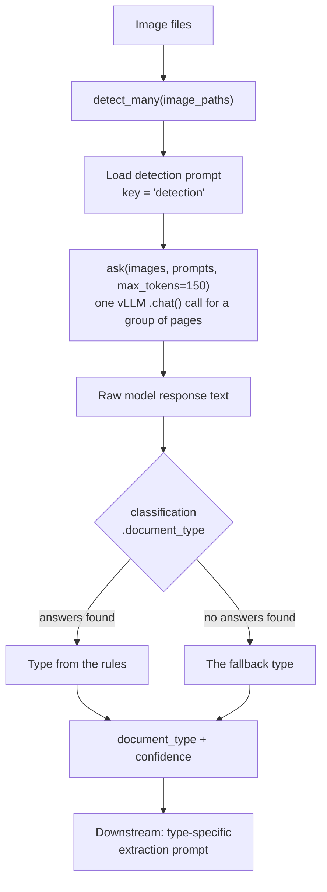
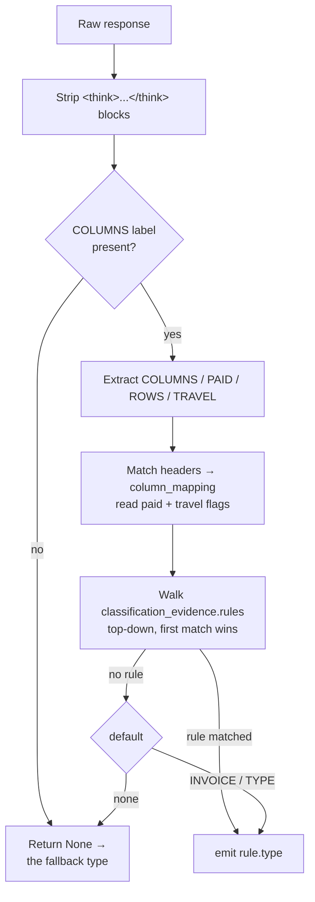
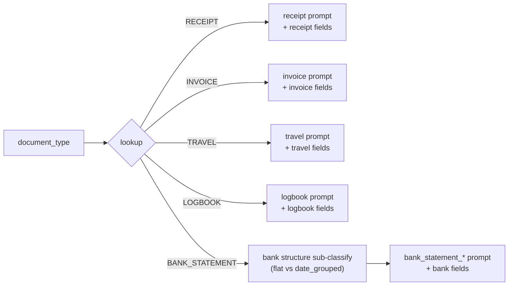

# Document Classification

> How the pipeline decides **what kind of document** an image is, before any
> field extraction happens. This is a self-contained guide for reusing the
> classification step on a new task.

## TL;DR

The classifier takes an image and returns a **canonical document type**
(`RECEIPT`, `INVOICE`, `BANK_STATEMENT`, `TRAVEL`, `LOGBOOK`, …). The novel part
is *how* it decides:

- The VLM is **not** asked "what document is this?". Instead it is asked a few
  concrete, observable questions (what are the table column headers, is there
  payment evidence, how many rows, is this a travel document).
- The Python layer then **derives the type from that evidence** using
  declarative rules in YAML (`classification_evidence`): the model reports
  facts, the rules make the decision. This is far more robust than trusting a
  model's one-word self-classification, especially with reasoning ("thinking")
  models that drift.

There are **two kinds of evidence**, and the difference matters when you add a
new type:

| Evidence kind | Example | Detects |
|---|---|---|
| **Column roles**: semantic columns recovered from the table headers | `debit`/`credit`/`balance`, `distance`/`odometer`/`purpose`, `gst`/`unit_price`/`quantity` | `BANK_STATEMENT`, `LOGBOOK`, `INVOICE` |
| **Boolean flags**: a direct YES/NO observation | `paid`, `travel` | `RECEIPT`, `TRAVEL` |

Boolean flags exist because some document types have **no distinctive table** to
key off. A flight itinerary/boarding pass has no financial ledger columns: the
model literally answers `COLUMNS: NONE`, so it can only be caught by asking a
dedicated `TRAVEL: YES/NO` question. See
[The TRAVEL case](#the-travel-case-when-columns-arent-enough).

If you want to adapt this to a new task, the pattern to copy is
**"ask for evidence, derive the label from declarative rules"**: see
[Reusing this for a new task](#reusing-this-for-a-new-task).

---

## Where it lives

| Component | Path |
|---|---|
| Entry method `detect_many()` | `models/orchestrator.py` |
| Evidence parser + rule evaluator | `common/classification.py` |
| Classification prompt + evidence rules (`column_roles`, `classification_evidence`) | `prompts/document_type_detection.yaml` |
| Pipeline stage (`KFP_TASK=classify`) | `stages/classify.py` |
| Config | `config/run_config.yml` (`classification:`, `token_budgets.classify`) |

---

## The big picture



**The contract**: `detect_many(image_paths) -> list[dict]`, one for each page:

```python
{
    "document_type": "RECEIPT",      # canonical label (UPPERCASE)
    "confidence": 1.0,               # 1.0 ok · 0.1 for a page that could not be asked about
    "raw_response": "...",           # full model text, kept for audit
    "prompt_used": "detection",
}
```

`detect_many` does not catch a failure. The classify stage sends pages several to a call
(`common/engine_calls.py`); a call that fails is tried again one page at a time, and a page that
still fails is recorded with the configured `fallback_type`, `confidence: 0.1` and its error, so
that one page never ends the run.

---

## Step 1: The prompt asks for *evidence*, not a verdict

The prompt is built from the questions in `prompts/document_type_detection.yaml`
(`classification.questions`): an opening line, then each question with its number
and label. With the four questions shipped it is deliberately small:

```text
Look at this document image and answer each question:

1. COLUMNS: If there is a transaction table with rows of dates,
   descriptions, and amounts, list the exact column headers
   separated by " | ".
   If there is no transaction table, write NONE.

2. PAID: Is there evidence that payment was completed?
   Look for: payment method, "PAID" stamp, amount tendered,
   change given, receipt number, EFTPOS/card details.
   Answer YES or NO.

3. ROWS: How many line items or transaction rows are visible?
   Answer with a number.

4. TRAVEL: Is this a flight ticket, e-ticket, boarding pass, or
   travel itinerary (showing passenger names, flights, or travel
   legs)? Answer YES or NO.
```

Each question yields one piece of evidence: `COLUMNS` → the column roles,
`PAID` → the `paid` flag, `ROWS` → a complexity tier, `TRAVEL` → the `travel`
flag. `Q1`/`Q3` are *column-role* evidence; `Q2`/`Q4` are *boolean-flag*
evidence (see the [TL;DR](#tldr) table).

Why this shape:

- **Observable questions** ("list the column headers", "is this a boarding
  pass") are things a VLM is good at. "Classify this document" forces it to do
  reasoning we can't inspect.
- The answers are **auditable**: `raw_response` is stored, so a wrong call can
  be traced to a wrong fact, not a black-box guess.
- It keeps the response **short** (`token_budgets.classify: 150`), which is fast
  and cheap.
- **Add evidence, not verdicts.** When a new type can't be told apart by the
  existing facts, the fix is to add a *new observable question* (as `TRAVEL` was
  added): never to ask the model for the final label.

> There is one classification prompt, `detection`. Two older ones that asked the
> model to name the type were removed on 24 November 2026: nothing sent them.

---

## Step 2: Derive the type from the evidence (YAML-driven rules)

`document_type()` (`common/classification.py`) turns the
answers into a label. The Python layer parses the evidence: matching headers to
a `column_mapping` and reading the `paid` / `travel` booleans; the **decision
itself is declared in YAML** (`classification_evidence` in
`prompts/document_type_detection.yaml`) and walked generically: no hardcoded
type heuristics:



The rules (`prompts/document_type_detection.yaml`): first match wins:

```yaml
classification_evidence:
  rules:
    - type: BANK_STATEMENT
      when: { any_roles: [debit, credit, balance] }   # financial ledger columns
    - type: LOGBOOK
      when: { any_roles: [distance, odometer, purpose] }
    - type: TRAVEL
      when: { travel: true }        # boolean flag: travel docs have no table
    - type: RECEIPT
      when: { paid: true }          # payment wins over an itemised table
    - type: INVOICE
      when: { any_roles: [gst, unit_price, quantity] }
  default: INVOICE                  # no match -> dominant non-bank/non-receipt type
```

`_evaluate_classification(column_mapping, paid, travel, evidence)` evaluates each
rule's `when:` clause against the present column roles and the `paid` / `travel`
flags, returning the first matching `type` (or the `default`). A `when:` clause
ANDs together any of these keys:

| `when:` key | Holds when |
|---|---|
| `any_roles: [...]` | at least one of the listed column roles is present |
| `all_roles: [...]` | every listed column role is present |
| `paid: true/false` | the `PAID` flag equals the given value |
| `travel: true/false` | the `TRAVEL` flag equals the given value |

**Order is precedence.** Column-based types (`BANK_STATEMENT`, `LOGBOOK`) are
checked first; `TRAVEL` sits before `RECEIPT` so a *paid* e-ticket stays
`TRAVEL` rather than being downgraded to a receipt. Adding a column-detectable
type is a pure YAML edit; adding a type that needs a brand-new fact requires a
prompt + parser change too: see
[Reusing this for a new task](#reusing-this-for-a-new-task).

> **`default: INVOICE`, not `none`.** A remote smoke (2026-06-20) showed
> `default: none` left unmatched docs without a type and sent ~21% of
> the dev set to `UNIVERSAL` (extracted with the generic 33-field prompt),
> dropping F1 mean 0.650 → 0.626. `INVOICE` restores parity and routes unmatched
> docs to the focused invoice prompt. Because the default is a hard type (not
> `none`), a reply whose answers can be read **never** gets the fallback type:
> see [Fallback path](#fallback-path).

Design points worth stealing:

- **Reasoning-model defence.** `<think>...</think>` blocks (and an unterminated
  `<think>` tail from a truncated response) are stripped *first*, so the model's
  internal monologue (e.g. "there's no table with headers like Date, Debit")
  can never be mistaken for the answer.
- **Prose is never harvested as data.** Column headers are only recovered from a
  genuinely tabular, pipe-delimited line (`>= 2` pipes). This stopped receipts
  being wrongly promoted to `BANK_STATEMENT` from a sentence that merely
  *mentioned* "balance".
- **Tables alone don't mean bank statement.** Invoices and receipts have tables
  too (Qty | Price | Total). The discriminator is specifically the financial
  columns `debit / credit / balance`.
- **Boolean flags survive verbose drift.** The `TRAVEL` answer is recovered both
  from the terse inline form (`4. TRAVEL: YES`) and from a verbose
  chain-of-thought reply where the conclusion lands on a later line
  (`### 4. TRAVEL` … `Answer: YES`). The recovery anchors on the field heading,
  strips the echoed "Answer YES or NO" instruction, and takes the last explicit
  YES/NO, so neither the question echo nor a prose mention ("not a travel doc")
  can be misread as the answer.

### The TRAVEL case: when columns aren't enough

`TRAVEL` is the worked example of *why boolean evidence exists*. Travel documents
(flight ticket, e-ticket, boarding pass, multi-leg itinerary) carry **no
transaction table**: asked for `COLUMNS`, the model answers `NONE` and even
reasons *"this is a boarding pass and does not contain a transaction table"*.

Two consequences:

1. A column-role approach for travel is a **dead end**: there are no
   `flight`/`gate`/`seat` headers to match because the model never reports a
   table. (This was tried and reverted; don't re-attempt it.)
2. Without a travel-specific signal, every itinerary matched no rule and fell to
   `default: INVOICE`.

The fix was to ask a **direct observable question** (`TRAVEL: YES/NO`) and add
a `when: { travel: true }` rule. On the `synthetic_20260622` set this moved all
10 travel docs from `INVOICE` to `TRAVEL` with no regression on the other types.
The takeaway: if a type has no distinctive table, give the classifier a boolean
flag, don't try to invent columns the model can't see.

### Fallback path

A reply whose answers cannot be read in any of the three forms (labelled, by
position, or under headings) gives the page `classification.fallback_type`
(`UNIVERSAL`). Nothing is guessed from words in the reply.

Until 24 November 2026 such a reply was matched against type names and keywords
(`type_mappings` and `fallback_keywords` in the same YAML). That format belonged
to an older prompt, which asked the model to name the type. Of 12,840 recorded
classification replies it was reached by 251, all from runs of that older prompt,
and by none since the four questions were asked. It was removed with its tables.

Because `classification_evidence.default` is a hard type (`INVOICE`), a reply
whose answers can be read but fit no rule resolves to `INVOICE`, not `UNIVERSAL`.
(Setting `default: none` would send those to the fallback type instead; it was
deliberately disabled: see the note above.)

---

## Step 3: Routing into extraction

The classification result selects the **type-specific extraction prompt** and
**field list** downstream (`read_pages()` in `orchestrator.py`):



Each type has its own extraction prompt and field list: a block under
`document_types` in `config/field_definitions.yaml`, and a prompt of the same name
in `prompts/extraction_prompts.yaml`. Every type is read the same way, a bank
statement included: there is no second classification step.

---

## Running the classify stage

In production this runs as its own KFP pod (`KFP_TASK=classify`). Never invoke
the module by hand: the entrypoint sets the model path, tiling, and GPU env:

```bash
KFP_TASK=classify bash entrypoint.sh
# → python3 -m stages, which runs the classify stage
```

**Input:** a directory of images.
**Output:** `classifications.jsonl`: one JSON record per image:

```json
{"image_path": "/data/img_001.png", "image_name": "img_001.png",
 "document_type": "RECEIPT", "confidence": 1.0,
 "raw_response": "1. COLUMNS: NONE\n2. PAID: YES\n3. ROWS: 4\n4. TRAVEL: NO",
 "prompt_used": "detection"}
```

The stage is **resumable**: on restart it skips images already present in the
output and appends, rather than re-classifying everything.

---

## Configuration

All knobs live in `config/run_config.yml` (YAML is the single source of truth:
there are no hardcoded Python defaults):

```yaml
pipeline:
  classification:
    fallback_type: UNIVERSAL   # the type of a page whose reply cannot be read

  token_budgets:
    classify: 150              # max tokens for the detection response
```

---

## Adding a document type

No Python changes, whichever case applies. Nothing in the code names a document
type or a question, and a test fails if a type's name appears in it.

### Always: the type's block and its prompt

1. Add a block for the type under `document_types` in
   `config/field_definitions.yaml`, with its `fields`. The head of that file says
   what else a block may hold: other names the type goes by, a fixed completion
   budget, and a table whose rows are lined up before scoring.
2. Add a prompt of the same name under `prompts:` in
   `prompts/extraction_prompts.yaml`. A type without a prompt, or a prompt without
   a type, stops the run with a message naming it.
3. For each field no other type already has, add an entry under `fields:` in the
   schema file. It says how a value of the field is tidied when a reply is
   cleaned, whether the field is a list, and how it is compared with the answer.
   A field with no entry stops the run with a message naming it.

### Case A: the questions already asked tell the type apart

If the type has a distinctive table column, or is separated by an answer already
asked for (`paid`, `travel`), add to `prompts/document_type_detection.yaml`:

1. (If column-based) the column's role under `column_roles:`, with the headings
   that play it.
2. A rule under `classification_evidence.rules`, at the right precedence.

### Case B: the type needs a new fact

This is what `TRAVEL` needed, because nothing asked told it apart. Add to
`prompts/document_type_detection.yaml`:

1. A question under `classification.questions`, with a `label`, `answer: yes_no`
   and the text to `ask`. It is asked last, with the next number.
2. A rule that uses it by its label in lower case, e.g. `when: { permit: true }`.

Adding a question changes the classification prompt for every page, so measure
classification on the sandbox before keeping it.

### Either case

Keep the questions concrete and answerable from the pixels (headers present? a
particular field present? a count? is it an X?), and put the most specific rule
first: order is precedence.

The reusable principle, regardless of domain:

> **Ask the VLM for facts it can see. Decide the label in code from those facts.**
> Strip any chain-of-thought before parsing, and only treat strongly-structured
> output (tables/pipes) as data: never prose.
